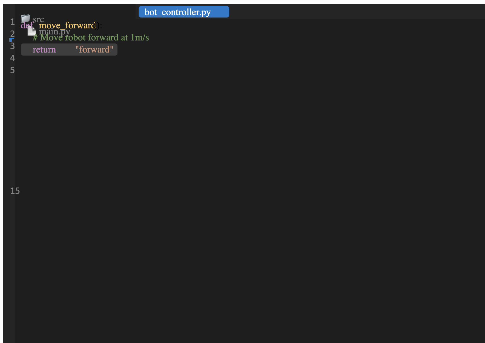
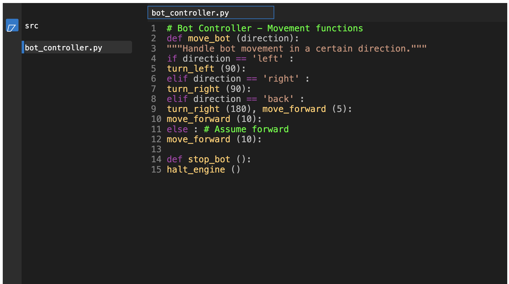

The SVG agent used [SVGBench](https://github.com/johnbean393/SVGBench) prompts such as “draw a red circle in the top-left corner.” A TypeScript server generated SVG markup, and a Python evaluator rendered it to an image. GPT-4.1 judged the image against the prompt's individual requirements. The fraction of requirements it met was its reward. [SVG evaluator source](https://github.com/eval-protocol/quickstart/blob/main/evaluator/svgagent.py)

<Note>
The original evaluator used `RemoteRolloutProcessor` to retrieve traces from the hosted Fireworks tracing gateway, which shut down on October 28, 2026. Running the Vercel server locally still requires that gateway to complete the original evaluation. Fireworks has also retired the managed RFT service used to train this agent.
</Note>

For a runnable local evaluation, follow the [GSM8K quickstart](/tutorial/gsm8k-finetuning-quickstart). For new reinforcement learning runs, see the [reinforcement learning recipe for the Fireworks Training API](https://docs.fireworks.ai/fine-tuning/training-api/cookbook/rl).

## Results from the original run

The following images show the same example after the first and eighth training epochs.

<Frame caption="First epoch">
  
</Frame>

<Frame caption="Eighth epoch">
  
</Frame>
