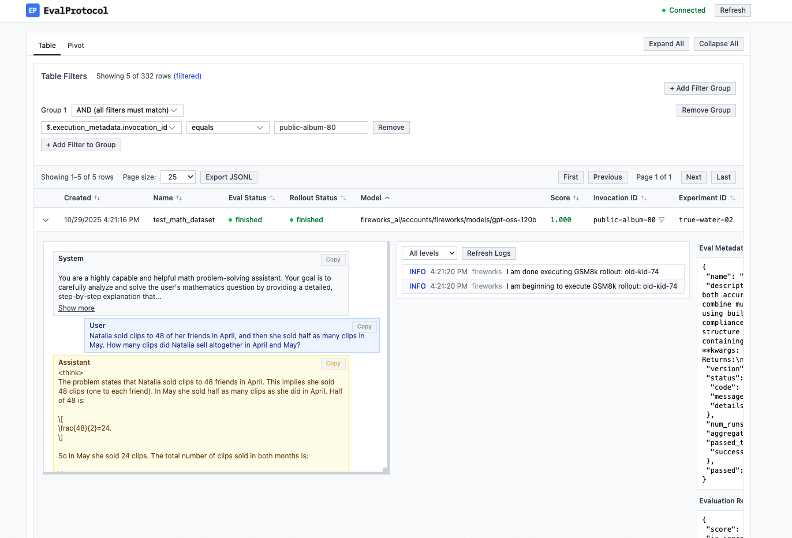

Run the evaluator on your machine using the five-row sample limit in the [GSM8K example](https://github.com/eval-protocol/quickstart-gsm8k). Its single-turn rollout processor sends the prompts to Fireworks for inference. Set `FIREWORKS_API_KEY` in your shell before running the evaluation. Model calls use your Fireworks account.

## Install the example

Use Python 3.10 or later. The repository includes the evaluator and its sample dataset.

```bash
git clone https://github.com/eval-protocol/quickstart-gsm8k.git
cd quickstart-gsm8k
python -m venv .venv
source .venv/bin/activate
python -m pip install -r requirements.txt
```

## Run and inspect the evaluation

```bash
ep local-test --entry evaluation.py::gsm8k_example
```

The evaluator reads `gsm8k_sample.jsonl`, extracts the first sequence of digits inside the model's `<answer>` tags, and compares it with the expected answer. A match scores 1. A mismatch or a missing answer scores 0. Inspect the per-row scores and reasons to distinguish arithmetic mistakes from formatting errors.

To view the results, run `ep logs` from the same directory and open [the local results viewer](http://localhost:8000).



To evaluate another model, change `completion_params` in `evaluation.py` and rerun the same sample. For reinforcement learning with this reward, follow the [reinforcement learning recipe for the Fireworks Training API](https://docs.fireworks.ai/fine-tuning/training-api/cookbook/rl).
